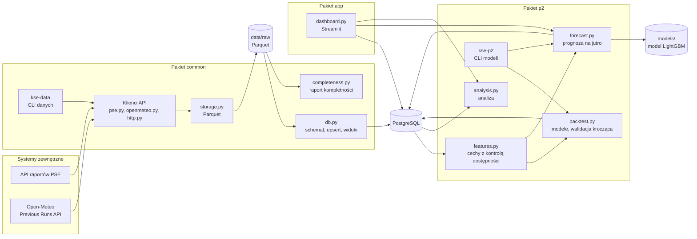
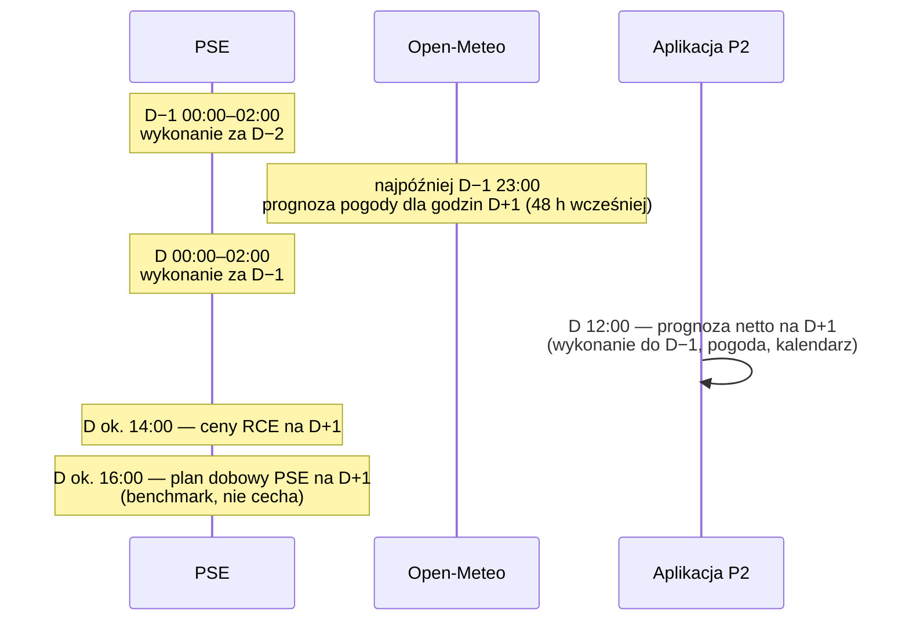
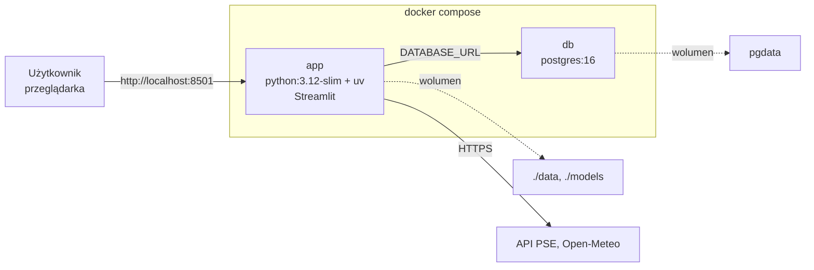

# 2. Architektura

## 2.1 Komponenty

| Pakiet | Moduły | Odpowiedzialność |
|---|---|---|
| `common` | `pse.py`, `openmeteo.py`, `http.py`, `storage.py`, `db.py`, `completeness.py`, `config.py`, `cli.py` | pobieranie danych z API (paginacja, ponawianie), zapis surowy, baza danych, kontrola jakości danych, konfiguracja |
| `p2` | `features.py`, `backtest.py`, `forecast.py`, `metrics.py`, `analysis.py`, `plots.py`, `cli.py` | cechy, modele, walidacja, prognoza na jutro, metryki, analiza |
| `app` | `dashboard.py`, `data.py`, `charts.py`, `run.py` | interfejs użytkownika |
| `inz` | — | miejsce na pracę inżynierską (poza zakresem P2) |

Logika znajduje się w plikach `.py`; notebook `p2/notebooks/P2.4_analiza.ipynb` tylko uruchamia funkcje analizy.

## 2.2 Przepływ danych
1. **Pobieranie** (`kse-data pse`, `kse-data weather`): zapytania do API w kawałkach miesięcznych, zapis do `data/raw/` (Parquet). Ponowne pobranie miesiąca zastępuje doby objęte pobraniem — PSE koryguje dane wstecz.
2. **Kontrola** (`kse-data report`): liczba kwadransów na dobę (92/96/100 przy zmianie czasu), duplikaty, braki.
3. **Ładowanie** (`kse-data load`): upsert do tabel PostgreSQL; zgodność liczby wierszy (`kse-data db-check`).
4. **Agregacja**: widoki godzinowe w bazie (średnie z czterech kwadransów), w tym zmienna docelowa `net_demand = demand − pv`.
5. **Modelowanie** (`kse-p2 backtest`): cechy → modele → walidacja krocząca → metryki; przebiegi i prognozy historyczne zapisane w bazie.
6. **Prognoza na jutro** (`kse-p2 forecast` albo przycisk w dashboardzie): odświeżenie danych, trening, prognoza D+1, zapis.
7. **Prezentacja** (`kse-app`): dashboard czyta widoki i prognozy z bazy.

## 2.3 Moment prognozy i dostępność informacji
Prognoza jest wykonywana w dniu **D o 12:00** czasu lokalnego na doby **D+1**. Model korzysta tylko z informacji dostępnych w tym momencie — brak przecieku informacji jest sprawdzany testem automatycznym (rozdz. 6).

| Informacja | Dostępna o 12:00 dnia D | Użycie |
|---|---|---|
| Wykonanie KSE (`demand`, `pv`) | doby do D−1 włącznie (decyzja z 13.11) | cechy historyczne |
| Prognoza pogody Open-Meteo `_previous_day2` | tak — wydana 48 h przed godziną docelową | cechy pogodowe |
| Kalendarz (dzień tygodnia, święta) | tak | cechy kalendarzowe |
| Plan dobowy PSE na D+1 | nie — publikowany ok. 16:00 | tylko porównanie (benchmark) |

Zmienna `_previous_day1` (prognoza wydana 24 h przed godziną docelową) dla godzin D+1 po ok. 12:00 byłaby wydana po momencie prognozy — dlatego wybrano `_previous_day2` (decyzja z 13.11).

## 2.4 Wdrożenie

Konfiguracja: plik `.env` (wzór `.env.example`) — dane logowania do bazy, `DATABASE_URL`, porty. Brak logowania użytkowników (decyzja z 01.11).
