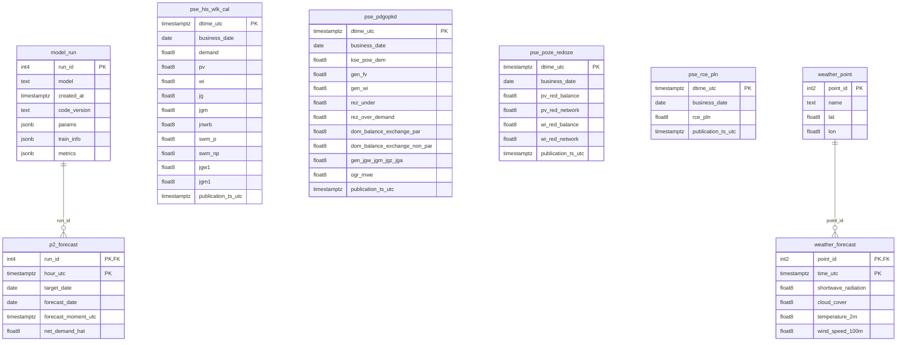

# 3. Model danych

Baza PostgreSQL 16. Schemat definiuje `common/db.py`; diagram generowany z tego samego kodu (`uv run kse-data erd --out docs/erd.md`).

## 3.1 ERD

Tabele `pse_*` nie mają kluczy obcych — łączy je czas (`dtime_utc`, koniec kwadransu w UTC; widoki godzinowe łączą się po `hour_utc`).

## 3.2 Tabele
| Tabela | Klucz | Zawartość | Wiersze (13.11.2026) |
|---|---|---|---|
| `pse_his_wlk_cal` | `dtime_utc` | wykonanie KSE co 15 min [MW]: zapotrzebowanie, PV, wiatr, składowe bilansu | 84 772 |
| `pse_pdgopkd` | `dtime_utc` | plan koordynacyjny dobowy PSE na D+1 [MW] | 84 772 |
| `pse_poze_redoze` | `dtime_utc` | nierynkowe redysponowanie OZE [MW] (od 27.09.2024; dla pracy inżynierskiej) | 74 692 |
| `pse_rce_pln` | `dtime_utc` | rynkowa cena energii RCE [zł/MWh] (dla pracy inżynierskiej) | 84 772 |
| `weather_point` | `point_id` | 8 punktów pogodowych (Warszawa, Kraków, Wrocław, Poznań, Gdańsk, Rzeszów, Białystok, Szczecin) | 8 |
| `weather_forecast` | `point_id`, `time_utc` | prognoza pogody wydana 48 h przed godziną docelową | 169 728 |
| `model_run` | `run_id` | rejestr przebiegów modeli (FR-06): model, wersja kodu, parametry i cechy, okna treningowe, metryki | — |
| `p2_forecast` | `run_id`, `hour_utc` | prognozy netto na D+1 (FR-09): z walidacji kroczącej (`naive_d1`, `naive_week`, `lightgbm`) i prognozy operacyjne (`lightgbm_operacyjny`, codziennie) | — |

Czas: wszystkie znaczniki w UTC (`timestamptz`); `dtime_utc` to koniec 15-minutowego interwału. Kolumny z danymi lokalnymi (`dtime`, `period`) i kolumny puste w raportach PSE nie są ładowane.

**Korekty danych:** PSE poprawia dane wstecz. Ładowanie używa `INSERT … ON CONFLICT (klucz) DO UPDATE` — nowa wersja rekordu nadpisuje poprzednią, bez duplikatów.

## 3.3 Widoki
| Widok | Zawartość |
|---|---|
| `v_wykonanie_h` | wykonanie godzinowe (średnia z kwadransów): `demand`, `pv`, `wi`, **`net_demand`** (zmienna docelowa), `n_quarters` (liczba kwadransów w godzinie) |
| `v_plan_h` | plan PSE godzinowo: `kse_pow_dem`, `gen_fv`, **`net_demand_pse`** (benchmark), `publication_ts_utc` |
| `v_rce_h` | RCE godzinowo: średnia i minimum |
| `v_pogoda_h` | pogoda: średnia z 8 punktów dla każdej godziny |
| `v_p2_forecast_latest` | prognozy z ostatniego przebiegu każdego modelu |
| `v_p2_operational_eval` | prognozy operacyjne (`lightgbm_operacyjny`): dla każdej doby D+1 ostatnia prognoza wykonana w dniu D, z wykonaniem i planem PSE — podstawa zakładki „Historia prognoz” |

Godzina = przedział [h, h+1) w UTC; kwadrans o końcu `dtime_utc` należy do godziny `date_trunc('hour', dtime_utc − 15 min)`. Średnie godzinowe z widoku zgadzają się z wartościami z analizy wstępnej (`docs/etapy/P2.3.md`).
