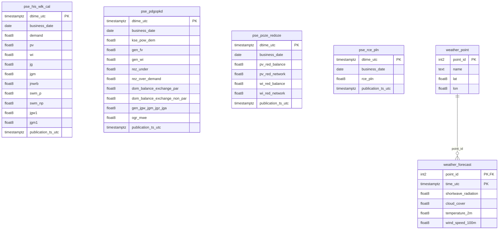

# ERD — baza danych

Wygenerowano ze schematu (`common/db.py`): `uv run kse-data erd --out docs/erd.md`.
Tabele `pse_*` nie mają kluczy obcych: łączy je czas (`dtime_utc`, koniec kwadransu UTC).
Widoki godzinowe: `v_wykonanie_h`, `v_plan_h`, `v_rce_h`, `v_pogoda_h` (opis: `docs/etapy/P2.3.md`).

