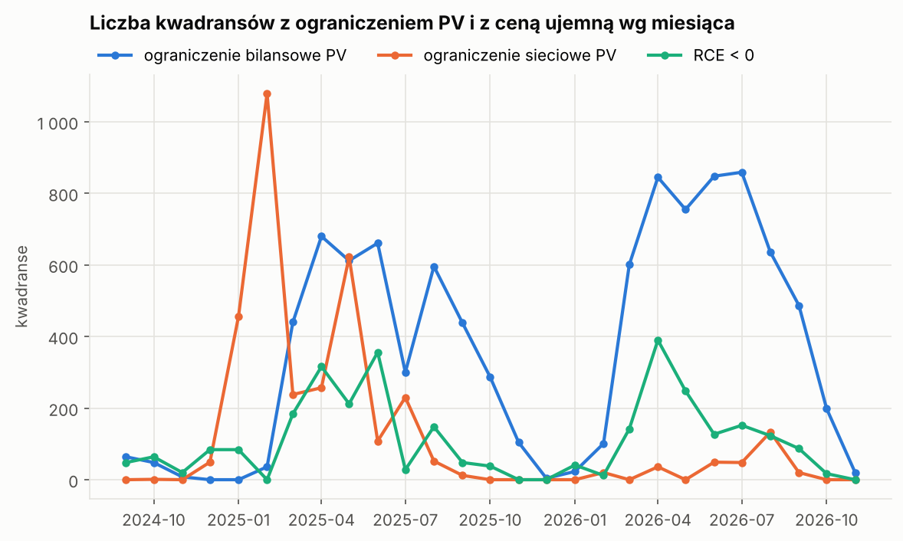
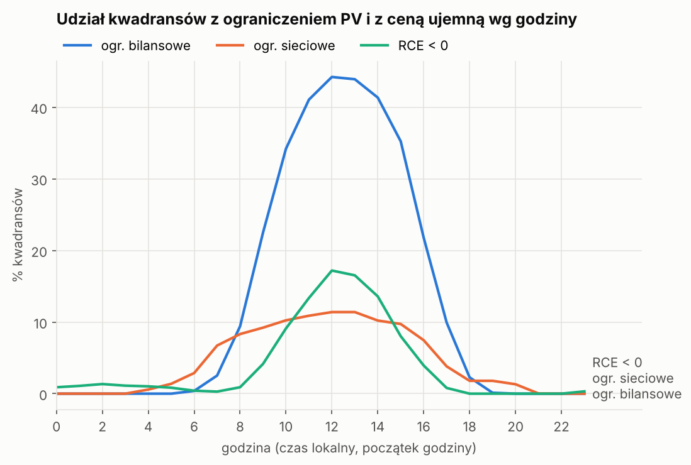

# I1 · Zbiór uczący inż

Data: 2026-11-16. Zadanie: `context/zadania/I1.md`. Statystyki: `docs/fig/i1_statystyki.md`. Wykresy: `docs/fig/i1_*.png`.

## Co powstało
| Plik | Rola |
|---|---|
| `inz/dataset.py` | budowa cech z kontrolą momentu dostępności (`build_day`), cele (`build_targets`), zapis i odczyt tabeli |
| `inz/stats.py` | statystyki celów: tabele, plik Markdown, wykresy |
| `inz/cli.py` | `uv run kse-inz dataset` |
| `common/db.py` | tabela `inz_dataset` (klucz `dtime_utc`) |
| `tests/test_inz_dataset.py` | 14 testów: **dostępność informacji (brak przecieku)**, definicje celów, zapis do bazy |
| `docs/erd.md` | ERD z nową tabelą |

## Jak uruchomić
```bash
docker compose up -d
uv run kse-data pse && uv run kse-data weather && uv run kse-data load
uv run kse-p2 backtest      # historyczne prognozy P2 (cecha zbioru), ok. 1 min
uv run kse-inz dataset      # ok. 1 min
```
Wynik: tabela `inz_dataset` w bazie (zastępowana w całości — zbiór jest odtwarzalny z danych), `docs/fig/i1_statystyki.md`, dwa wykresy. Opcja `--no-save` — bez zapisu do bazy.

## Struktura zbioru
Jeden wiersz = jeden kwadrans doby docelowej T = D+1 (`dtime_utc` — koniec interwału 15 min, UTC). Doba ma 92, 96 lub 100 kwadransów. Zakres: 27.09.2024 (początek raportu `poze-redoze`) – ostatnia doba z planem PSE.

| Grupa | Kolumny | Źródło | Dostępne |
|---|---|---|---|
| kalendarz | `quarter_local` (0–95), `dow`, `month`, `doy_sin`, `doy_cos`, `is_holiday`, `is_weekend` | data doby T | zawsze |
| plan PSE na T | `kse_pow_dem`, `gen_fv`, `gen_wi`, `rez_under`, `rez_over_demand`, `dom_balance_exchange_par`, `dom_balance_exchange_non_par`, `gen_jgw_jgm_jgz_jga`, `ogr_mwe` | `pse_pdgopkd` (kwadransowo) | ok. 16:00 dnia D |
| prognoza P2 | `p2_net_demand_hat` | `v_p2_forecast_latest`, model `lightgbm` (walidacja krocząca P2.5) | 12:00 dnia D |
| pogoda | `shortwave_radiation`, `cloud_cover`, `temperature_2m`, `wind_speed_100m` | `v_pogoda_h` (`_previous_day2`, średnia z 8 punktów) | 12:00 dnia D |
| cele | `pv_red_balance_mw`, `pv_red_network_mw`, `y_red_balance`, `y_red_network`, `y_rce_neg` | `pse_poze_redoze`, `pse_rce_pln` | po dobie T |
| pomocnicze | `plan_publication_ts_utc`, `red_publication_ts_utc`, `red_pv0_anomaly`, `rce_pln` | — | nie są cechami |

Prognoza P2 i pogoda są godzinowe: kwadrans dostaje wartość godziny UTC, do której należy (4 jednakowe wartości; ta sama konwencja co widoki godzinowe bazy i cechy P2).

Listy cech w kodzie:
- `FEATURES_C1` (cel 1, ograniczenia PV; prognoza po publikacji planu PSE): kalendarz + plan + P2 + pogoda — 21 cech.
- `FEATURES_C2` (cel 2, ceny ujemne; prognoza o 12:00 dnia D): kalendarz + P2 + pogoda — 12 cech, **bez planu PSE na T** (jeszcze nieopublikowany).

## Kontrola dostępności informacji
Cechy każdej doby buduje `build_day(d, plan, p2_forecast, weather)`, która sama odcina dane niedostępne w dniu D:

| Źródło | Warunek w kodzie |
|---|---|
| plan PSE | wiersze doby T z `publication_ts_utc` < początek doby T (`available_plan`) |
| prognoza P2 | `target_date` = T i `forecast_moment_utc` ≤ 12:00 dnia D (`available_p2`) |
| pogoda | `time_utc` − 48 h ≤ 12:00 dnia D (`p2.features.available_weather`) |
| wykonanie KSE, ograniczenia OZE, RCE | nie są argumentami `build_day` — cechy nie mogą od nich zależeć |

Sprawdzone na danych: plan PSE każdej z 887 dób został opublikowany przed początkiem doby (od 3,5 h do 8,8 h wcześniej, mediana 8,2 h; jedna wersja publikacji na dobę) — w zbiorze 0 kwadransów bez planu.

Momentem prognozy celu 1 jest publikacja planu PSE, nie sztywna godzina 16:00 (plan bywa publikowany później, najpóźniej 3,5 h przed dobą). Pogoda dla celu 1 jest ta sama co dla celu 2 (`_previous_day2`, wydana do 12:00 dnia D) — świeższa prognoza pogody z godziny 16:00 nie jest używana.

## Cele (`build_targets`)
- **Ograniczenie PV [MW]** = −wartość z `poze-redoze` (w raporcie redukcja jest ujemna); `NULL` w raporcie = 0. Osobno bilansowe (`pv_red_balance_mw`) i sieciowe (`pv_red_network_mw`).
- **Flagi** `y_red_balance`, `y_red_network` = ograniczenie > 0.
- **`y_rce_neg`** = `rce_pln` < 0 (cena równa 0 nie jest ujemna; 99 takich kwadransów).
- **Cele ograniczeń są określone tylko dla kwadransów z wykonaniem KSE** (`pv` w `his-wlk-cal`). Powód: raport `poze-redoze` zawiera puste wiersze także dla doby bieżącej i przyszłej (publikowane 2 doby wcześniej), więc sam wiersz nie oznacza braku ograniczeń. Dla takich kwadransów cele = `NULL`.
- **Reguła czyszczenia (pułapka 5):** ograniczenie zgłoszone przy wykonanej generacji `pv = 0` jest zerowane, a kwadrans oznaczony `red_pv0_anomaly = 1`. W danych: 102 kwadranse, wszystkie to ograniczenia sieciowe 0,1–3,0 MW o świcie lub zmierzchu.

## Wyniki — statystyki celów
Stan na 16.11.2026 (dane do 16.11, plan do 17.11). Pełne tabele (miesiące, godziny): `docs/fig/i1_statystyki.md`.

| | wartość |
|---|---|
| kwadranse / doby w zbiorze | 75 076 / 782 |
| kwadranse z celami ograniczeń | 74 949 |
| udział kwadransów z ograniczeniem bilansowym | 12,88% |
| udział kwadransów z ograniczeniem sieciowym | 4,55% |
| udział kwadransów z RCE < 0 | 3,95% |

| Rok | doby | kwadranse | ogr. bilansowe [kw.] | ogr. sieciowe [kw.] | doby z ogr. bilansowym | RCE < 0 [kw.] | doby z RCE < 0 |
|---|---|---|---|---|---|---|---|
| 2024 (od 27.09) | 96 | 9 220 | 120 | 50 | 7 | 216 | 13 |
| 2025 | 365 | 35 040 | 4 158 | 3 054 | 173 | 1 414 | 72 |
| 2026 (do 16.11) | 320 | 30 689 | 5 374 | 306 | 206 | 1 339 | 80 |

Wielkość ograniczeń w kwadransach z ograniczeniem [MW]:
| | kwadranse | średnia | p10 | mediana | p90 | maks. |
|---|---|---|---|---|---|---|
| bilansowe | 9 652 | 932 | 129 | 787 | 1 941 | 4 160 |
| sieciowe | 3 410 | 20 | 1,5 | 12 | 42 | 220 |

Ceny ujemne a ograniczenia:
| Kwadranse | liczba | P(RCE < 0) |
|---|---|---|
| z ograniczeniem bilansowym | 9 652 | 0,262 |
| tylko z ograniczeniem sieciowym | 2 746 | 0,025 |
| bez ograniczeń | 62 551 | 0,006 |

Obserwacje (fakty z danych):
- Ograniczenia bilansowe są sezonowe (marzec–październik) i skupione w godzinach 9–16 czasu lokalnego; w godzinach 12–13 występują w 44% kwadransów (`i1_cele_godziny.png`).
- Podział trening (≤ 2025) / test (2026): 4 278 kwadransów z ograniczeniem bilansowym w treningu, 5 374 w teście. W 2026 ograniczeń bilansowych jest więcej niż w całym 2025.
- Ograniczenia sieciowe są o rząd wielkości mniejsze (mediana 12 MW wobec 787 MW) i w 90% przypadają na okres 12.2024–08.2025 (szczyt: luty 2025, 1 079 kwadransów); w 2026 jest ich 306 (`i1_cele_miesiace.png`).
- Ceny ujemne występują także nocą (ok. 1% kwadransów w godzinach 0–5), czyli nie tylko przy generacji PV.

Braki cech: plan PSE — 0; prognoza P2 — 192 kwadranse (doby 16–17.11: walidacja krocząca P2 kończy się na ostatniej pełnej dobie wykonania); pogoda — 96 kwadransów (17.11, jeszcze niepobrana).




## Testy (`tests/test_inz_dataset.py`)
- `test_no_leakage` (2 doby): prognoza P2 wykonana po 12:00 dnia D, pogoda wydana po 12:00 dnia D i plany innych dób mnożone ×10 — cechy doby D+1 muszą być identyczne.
- `test_late_p2_forecast_and_late_plan_are_not_used`: prognoza P2 spóźniona o minutę oraz plan opublikowany po rozpoczęciu doby dają puste cechy.
- `test_feature_lists_respect_forecast_moments`: `FEATURES_C2` bez planu PSE; wśród cech nie ma celów, cen ani wykonania.
- `test_features_do_not_depend_on_targets`: zmiana ograniczeń, cen i wykonania nie zmienia cech.
- `test_available_data_is_used`: kontrola czułości — zmiana danych dostępnych zmienia cechy.
- `test_targets_definition`, `test_targets_unknown_without_actuals_and_pv0_rule`: znak, `NULL` = 0, cel nieokreślony bez wykonania, reguła `pv = 0`.
- `test_quarters_of_business_day`: 92 / 96 / 100 kwadransów (zmiana czasu).
- `test_save_replaces_table_and_roundtrip`: zapis i odczyt na PostgreSQL (schemat tymczasowy).

## Decyzje techniczne
| Decyzja | Powód |
|---|---|
| Jedna tabela dla obu celów, dwie listy cech (`FEATURES_C1`, `FEATURES_C2`) | różni je tylko dostępność planu PSE; jedna budowa i jeden zestaw testów |
| Cechy budowane osobno dla każdej doby, odcięcie danych wewnątrz `build_day` | jak w P2.5: kontrola dostępności w jednym miejscu, testowalna perturbacją |
| Plan PSE: tylko wersja opublikowana przed początkiem doby | ochrona przed późniejszą korektą planu (w obecnych danych nie występuje) |
| Surowe kolumny planu, bez cech pochodnych | cechy pochodne (np. zapotrzebowanie − PV − wiatr) należą do modelowania (I2) |
| Wartości godzinowe powtarzane w kwadransach, bez interpolacji | zgodność z cechami P2; brak dodatkowych założeń |
| Cele ograniczeń tylko przy istniejącym wykonaniu | puste wiersze `poze-redoze` dla dób przyszłych nie są informacją o braku ograniczeń |
| Tabela zastępowana w całości przy każdej budowie | zbiór zależy od ostatniego przebiegu P2 i korekt PSE; pełna odtwarzalność |

## Ograniczenia
- **Moment publikacji `poze-redoze` zmienił się w czasie.** Dla dób do 08.2026 89% kwadransów z ograniczeniem ma w API znacznik publikacji późniejszy niż 7 dni po dobie (korekty: mediana od ok. 3 tygodni do kilku miesięcy). Dla dób od 09.2026 — 25%; pozostałe mają znacznik z tej samej doby (ok. 11:30 UTC). API przechowuje tylko ostatnią wersję, więc nie wiadomo, czy wartości z ostatnich tygodni są ostateczne. Pytanie w `docs/STAN.md`.
- Doba bieżąca ma cele tylko dla kwadransów z już opublikowanym wykonaniem.
- Cechy pochodzą z wersji danych z dnia pobrania (pułapka 4). Plan PSE ma w API jedną wersję na dobę, opublikowaną przed dobą.
- Prognoza P2 w zbiorze pochodzi z walidacji kroczącej z douczaniem co miesiąc; prognoza operacyjna (codzienna) używa modelu uczonego do D−1.

## Jak sprawdzić samodzielnie
Po `uv sync`, `docker compose up -d` i załadowaniu danych (`uv run kse-data pse`, `uv run kse-data weather`, `uv run kse-data load`, `uv run kse-p2 backtest`):

1. `uv run pytest tests/test_inz_dataset.py -v` → 14 testów `PASSED`, w tym `test_no_leakage[...]` (2 przypadki).
2. `uv run kse-inz dataset` → po ok. 1 min tabele „Podsumowanie”, „Cele wg lat”, „Braki”; dla 2025: 35 040 kwadransów, 4 158 z ograniczeniem bilansowym, 1 414 z RCE < 0 (2026 rośnie z nowymi dobami).
3. `docker compose exec db psql -U kse -d kse -c "SELECT count(*), count(DISTINCT business_date), sum(y_red_balance), sum(y_rce_neg) FROM inz_dataset WHERE business_date <= '2026-10-31'"` → `73444 | 765 | 9632 | 2969`.
4. `docker compose exec db psql -U kse -d kse -c "SELECT business_date, count(*) FROM inz_dataset WHERE business_date IN ('2025-03-30','2025-10-26') GROUP BY 1 ORDER BY 1"` → 92 i 100 kwadransów (zmiana czasu).
