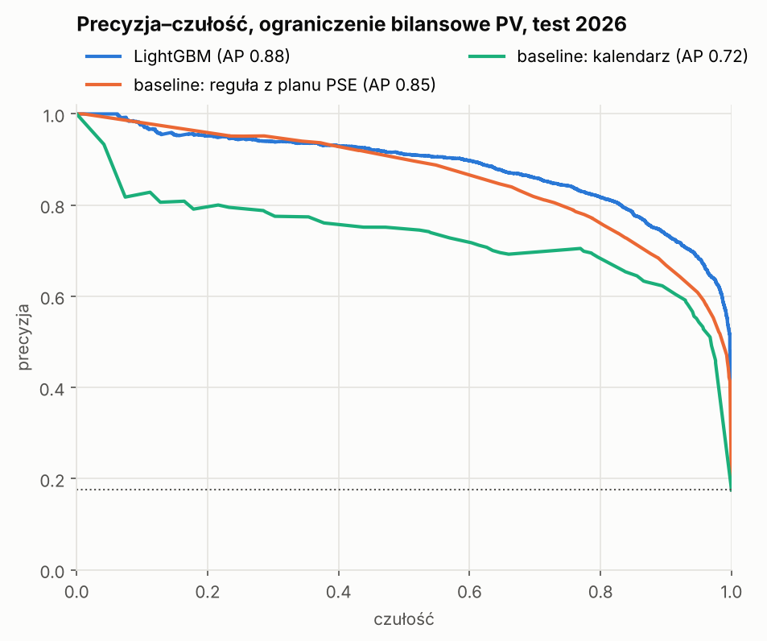
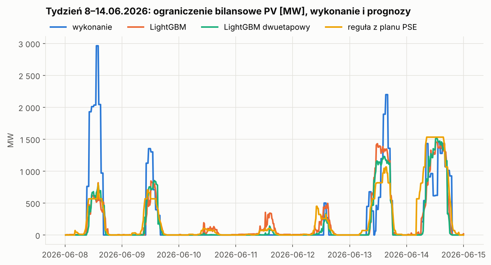

# I2 · Cel 1: modele bazowe i LightGBM

Data: 2026-11-16. Zadanie: `context/zadania/I2.md`. Pełne tabele: `docs/fig/i2_metryki.md`. Wykresy: `docs/fig/i2_*.png`.

## Co powstało
| Plik | Rola |
|---|---|
| `inz/models.py` | cechy pochodne z planu PSE, dwa modele bazowe, LightGBM (klasyfikator + regresor), wariant dwuetapowy regresji |
| `inz/evaluate.py` | metryki: AUC, AP, F1, precyzja, czułość, MAE; wybór progu F1 |
| `inz/experiment.py` | schematy walidacji (trening ≤ 2025 / krocząca), tabela metryk, zapis przebiegów i prognoz |
| `inz/plots.py` | krzywe precyzja–czułość |
| `inz/cli.py` | `uv run kse-inz c1` |
| `common/db.py` | tabela `inz_prediction` (prognozy na kwadrans; klucz `run_id`, `dtime_utc`) |
| `tests/test_inz_models.py` | 12 testów |
| `models/inz_c1_*_{clf,reg}.txt` | modele LightGBM uczone na dobach ≤ 31.12.2025 — poza gitem, odtwarzane poleceniem |

## Jak uruchomić
```bash
uv run kse-inz dataset   # zbiór uczący (I1)
uv run kse-inz c1        # ok. 4 min
```
Wynik: tabele na ekranie, `docs/fig/i2_metryki.md`, wykresy, modele w `models/`, 16 przebiegów w `model_run` (`inz_c1_<cel>_<model>_<schemat>`), prognozy testowe w `inz_prediction`. Opcja `--no-save` — bez zapisu do bazy.

## Zadanie modeli
Dla każdego kwadransu doby D+1, po publikacji planu PSE (ok. 16:00 dnia D):
- **klasyfikacja** — prawdopodobieństwo ograniczenia PV (`p_hat`),
- **regresja** — wielkość ograniczenia w MW (`mw_hat`, ≥ 0; także dla kwadransów bez ograniczenia, gdzie wartość rzeczywista = 0).

Dwa cele liczone tym samym kodem: ograniczenie **bilansowe** (główny) i **sieciowe**.

## Cechy (27)
21 cech zbioru (`FEATURES_C1`, opis w `docs/etapy/I1.md`) + 6 pochodnych, liczonych tylko z planu PSE na dobę D+1 i prognozy P2 (te same momenty dostępności):

| Cecha | Definicja |
|---|---|
| `res_load` | `kse_pow_dem − gen_fv − gen_wi` — zapotrzebowanie do pokrycia poza PV i wiatrem |
| `res_load_exch` | `res_load + dom_balance_exchange_par` |
| `pv_share` | `gen_fv / kse_pow_dem` — planowany udział PV w zapotrzebowaniu |
| `p2_minus_plan` | prognoza P2 netto − (`kse_pow_dem − gen_fv`) |
| `res_load_day_min`, `gen_fv_day_max` | minimum `res_load` i maksimum `gen_fv` w dobie D+1 |

Dane o ograniczeniach z poprzednich dób nie są cechami (publikacja z opóźnieniem, `00_fundament.md` sekcja 3).

## Modele
| Model | Opis |
|---|---|
| baseline: kalendarz | częstość ograniczenia i średnia wielkość w treningu dla pary (miesiąc, kwadrans doby); miesiąc spoza treningu → średnia wg kwadransu |
| baseline: reguła z planu PSE | jedna zmienna `res_load`: im niższa, tym większe ryzyko; zależność monotoniczna dopasowana w treningu (regresja izotoniczna) osobno dla prawdopodobieństwa i MW; przy planowanej generacji PV = 0 wynik 0 |
| LightGBM | klasyfikator (`binary`) i regresor (`regression`, L2, wszystkie kwadranse); parametry stałe jak w P2.5: 600 drzew, `learning_rate` 0,03, `num_leaves` 31, podpróbkowanie 0,8; ziarno 42, tryb deterministyczny |
| LightGBM (regresja dwuetapowa) | ten sam klasyfikator; `mw_hat` = `p_hat` × prognoza regresora uczonego tylko na kwadransach z ograniczeniem |

Model „jak wczoraj” nie jest możliwy: ograniczenia z doby D nie są znane w chwili prognozy.

## Walidacja
- **Trening ≤ 2025** (decyzja 01.11): model uczony na dobach 27.09.2024–31.12.2025 (44 260 kwadransów), test 01.01–15.11.2026 (30 624 kwadranse, 319 dób). Tylko doby z kompletem celów.
- **Krocząca**: model douczany co miesiąc na rosnącym oknie. Model dla miesiąca M uczony na dobach do końca miesiąca M−2 (np. marzec 2026 ← dane do 31.01.2026). Odstęp wynika z opóźnienia publikacji `poze-redoze` (mediana ok. 3 tygodnie): doby z miesiąca M−1 nie są w całości znane w chwili prognozy.
- **Próg decyzyjny** (dla F1, precyzji, czułości): wyznaczany wyłącznie na okresie treningowym — prognozy krzyżowe (5 części, grupy = miesiące kalendarzowe), próg maksymalizujący F1. Ten sam próg w obu schematach. AUC i AP nie zależą od progu.

## Wyniki — ograniczenie bilansowe PV
Test: 30 624 kwadranse, 5 374 z ograniczeniem (17,5%). MAE prognozy zerowej: 165 MW.

| Model | Walidacja | AUC | AP | F1 | precyzja | czułość | MAE [MW] | MAE_ogr [MW] |
|---|---|---|---|---|---|---|---|---|
| baseline: kalendarz | trening ≤ 2025 | 0,938 | 0,722 | 0,735 | 0,656 | 0,836 | 147 | 622 |
| baseline: reguła z planu PSE | trening ≤ 2025 | 0,967 | 0,846 | 0,777 | 0,779 | 0,775 | 140 | 629 |
| **LightGBM** | trening ≤ 2025 | **0,976** | **0,882** | **0,808** | 0,819 | 0,798 | 132 | **535** |
| LightGBM (regresja dwuetapowa) | trening ≤ 2025 | 0,976 | 0,882 | 0,808 | 0,819 | 0,798 | **118** | 563 |
| baseline: reguła z planu PSE | krocząca | 0,964 | 0,842 | 0,778 | 0,773 | 0,782 | 145 | 618 |
| **LightGBM** | krocząca | **0,977** | **0,886** | **0,823** | 0,814 | 0,833 | 121 | **514** |
| LightGBM (regresja dwuetapowa) | krocząca | 0,977 | 0,886 | 0,823 | 0,814 | 0,833 | **117** | 547 |

MAE — wszystkie kwadranse testu; MAE_ogr — tylko kwadranse z ograniczeniem (średnie ograniczenie w tych kwadransach: 939 MW). Baseline kalendarzowy w walidacji kroczącej ma wyniki identyczne jak przy treningu ≤ 2025: dla miesiąca M korzysta tylko z tego samego miesiąca lat poprzednich.

Tylko kwadranse z planowaną generacją PV > 0 (17 912; noc nie zawyża wyniku): LightGBM AUC 0,952, AP 0,882; reguła z planu 0,934 / 0,847; kalendarz 0,888 / 0,725.

Obserwacje (fakty z wyników):
- LightGBM jest lepszy od obu modeli bazowych we wszystkich metrykach. Względem reguły z planu PSE: AP +0,036, F1 +0,031, MAE −5% (−16% w wariancie dwuetapowym), MAE_ogr −15%.
- Reguła z jednej zmiennej planu PSE (`res_load`) jest mocnym punktem odniesienia: AUC 0,967. Większość informacji o ograniczeniach bilansowych jest w planie PSE.
- Wynik jest zgodny ze wstępnym sprawdzeniem z 01.11 (`00_fundament.md`: AUC 0,97; AP 0,87 wobec 0,70 dla kalendarza).
- Regresja: wariant dwuetapowy ma niższy MAE na wszystkich kwadransach (118 wobec 132 MW), a wyższy na kwadransach z ograniczeniem (563 wobec 535 MW) — mniej fałszywych niezerowych prognoz, ale większe niedoszacowanie dużych ograniczeń.
- Wszystkie modele niedoszacowują największe ograniczenia (przykład: 8.06.2026, wykonanie do 2 960 MW, prognozy do ok. 800 MW — `i2_tydzien_balance.png`).
- Douczanie co miesiąc poprawia LightGBM: F1 0,808 → 0,823, MAE 132 → 121 MW.
- Wg miesięcy (LightGBM, trening ≤ 2025): w sezonie III–IX AP 0,85–0,94; poza sezonem, przy małej liczbie zdarzeń, wyraźnie niżej (styczeń: 23 kwadranse, AP 0,11; listopad: 20, AP 0,20).
- Najważniejsze cechy klasyfikatora (gain): `pv_share` 40%, `shortwave_radiation` 11%, `rez_under` 8%, `gen_fv` 6%, `res_load` 4%. Regresor: `pv_share` 32%, `res_load` 13%, `p2_net_demand_hat` 10%.




## Wyniki — ograniczenie sieciowe PV
Test: 306 kwadransów z ograniczeniem (1,0%), średnio 31 MW. MAE prognozy zerowej: 0,3 MW.

| Model (trening ≤ 2025) | AUC | AP | F1 | MAE [MW] |
|---|---|---|---|---|
| baseline: kalendarz | 0,620 | 0,013 | 0,029 | 2,1 |
| baseline: reguła z planu PSE | 0,736 | 0,019 | 0,034 | 2,0 |
| LightGBM | 0,819 | 0,027 | 0,055 | 3,2 |
| LightGBM (regresja dwuetapowa) | 0,819 | 0,027 | 0,055 | 1,5 |

Ograniczeń sieciowych nie da się użytecznie prognozować z tych cech: AP 0,03 przy częstości 0,01, a każdy model ma MAE wyższy niż prognoza zerowa (0,3 MW). Fakty z danych, które to tłumaczą (`docs/etapy/I1.md`): 90% ograniczeń sieciowych przypada na 12.2024–08.2025, w 2026 jest ich 306; są małe (mediana 12 MW) i wynikają z lokalnych warunków sieci, a cechy opisują cały kraj.

## Zapis w bazie
- `model_run`: 16 przebiegów — 2 cele × 4 modele × 2 schematy; `params` (parametry, cechy, cel, schemat, próg), `train_info` (okna walidacji kroczącej), `metrics`.
- `inz_prediction`: 30 624 prognozy na przebieg (`p_hat`, `mw_hat`) — źródło dla widoków I5 (epizody historyczne, porównanie modeli) i dla tabeli porównawczej z sieciami (I3).
- Powtórne uruchomienie daje identyczne metryki (sprawdzone: dwa przebiegi, identyczny plik `i2_metryki.md`).

## Testy (`tests/test_inz_models.py`)
- `test_model_features_have_no_targets_or_actuals`: wśród cech modeli nie ma celów, cen ani wykonania.
- `test_add_derived`: definicje cech pochodnych; agregaty dobowe zależą tylko od własnej doby.
- `test_static_scheme_and_thresholds_do_not_use_test_targets`: zmiana celów w okresie testowym nie zmienia progów ani prognoz modelu uczonego ≤ 2025.
- `test_experiment_structure`, `test_walk_cutoff_is_end_of_month_minus_two`: w walidacji kroczącej trening kończy się na końcu miesiąca M−2; komplet prognoz dla każdego modelu i schematu.
- `test_calendar_baseline_frequencies_and_fallback`, `test_plan_rule_is_monotone_and_zero_without_pv`, `test_lightgbm_learns_synthetic_rule` (2 warianty), `test_metrics_and_threshold`, `test_prepare_keeps_only_complete_days`, `test_save_runs_and_predictions`.

## Decyzje techniczne
| Decyzja | Powód |
|---|---|
| Oba cele (bilansowe, sieciowe) tym samym kodem; bilansowe jako główny | bilansowe to 78% kwadransów z ograniczeniem i prawie cały wolumen (mediana 787 MW wobec 12 MW) |
| Reguła z planu: jedna zmienna + regresja izotoniczna | prosta, monotoniczna reguła bez założeń o progu; daje prawdopodobieństwo i MW |
| Stałe hiperparametry LightGBM (jak w P2.5), bez strojenia | porównywalność z P2; strojenie poza zakresem etapu |
| Próg F1 z prognoz krzyżowych na treningu | próg z prognoz na danych treningowych modelu byłby zaniżony (dopasowanie); test nie bierze udziału w wyborze progu |
| Odstęp jednego miesiąca w walidacji kroczącej | opóźnienie publikacji `poze-redoze`; bez odstępu model uczyłby się na danych nieznanych w chwili prognozy |
| Dwa warianty regresji w tabeli | różnią się kompromisem: MAE ogółem vs MAE w kwadransach z ograniczeniem; wybór wariantu dla systemu (I5) wymaga wskazania, która miara jest ważniejsza |
| Metryki także dla kwadransów z PV > 0 | kwadranse nocne są trywialnie ujemne i zawyżają AUC |

## Ograniczenia
- Trening obejmuje jeden pełny sezon (2025); w 2026 ograniczeń bilansowych jest więcej niż w całym 2025.
- Przy treningu ≤ 2025 model korzysta z danych o ograniczeniach z grudnia 2025, które w rzeczywistości mogły być opublikowane po 1.01.2026; schemat kroczący uwzględnia to odstępem.
- Dane o ograniczeniach z ostatnich tygodni mogą nie być ostateczne (`docs/etapy/I1.md`, Ograniczenia).
- Cechy w wersji danych z dnia pobrania (pułapka 4).

## Jak sprawdzić samodzielnie
Po `uv sync`, `docker compose up -d`, załadowaniu danych i `uv run kse-inz dataset`:

1. `uv run pytest tests/test_inz_models.py -v` → 12 testów `PASSED`.
2. `uv run kse-inz c1 --no-save` → po ok. 4 min dwie tabele; dla ograniczenia bilansowego `lightgbm staly`: AUC ok. 0,976, AP ok. 0,88, F1 ok. 0,81, MAE ok. 132; `baseline_plan staly`: AUC ok. 0,967, AP ok. 0,85 (przy nowych dobach wartości zmieniają się nieznacznie).
3. `docker compose exec db psql -U kse -d kse -c "SELECT model, round((metrics->>'AP')::numeric,3) ap, round((metrics->>'MAE')::numeric) mae FROM model_run WHERE model LIKE 'inz_c1_balance%' ORDER BY run_id"` → 8 przebiegów z metrykami (po `kse-inz c1` bez `--no-save`).
4. `docker compose exec db psql -U kse -d kse -c "SELECT count(DISTINCT run_id), count(*) FROM inz_prediction"` → 16 przebiegów, 16 × liczba kwadransów testowych.
