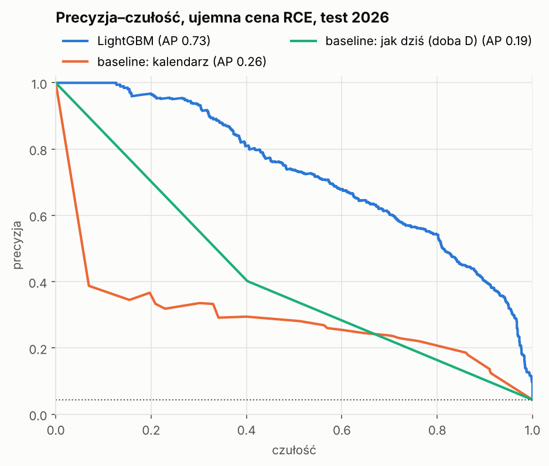

# I4 · Cel 2: ujemne ceny RCE

Data: 2026-11-16. Zadanie: `context/zadania/I4.md`. Pełne tabele: `docs/fig/i4_metryki.md`. Wykres: `docs/fig/i4_pr_rce_neg.png`.

## Co powstało
| Plik | Rola |
|---|---|
| `inz/c2.py` | cechy celu 2 z kontrolą dostępności (`add_features`), model bazowy „jak dziś”, LightGBM z listą cech celu 2 |
| `inz/models.py`, `inz/experiment.py` | cel bez regresji (tylko klasyfikacja); odstęp walidacji kroczącej zależny od opóźnienia publikacji celu; nazwy przebiegów `inz_<cel>_…` |
| `inz/cli.py` | `uv run kse-inz c2` |
| `tests/test_inz_c2.py` | 8 testów, w tym brak przecieku z cen doby prognozowanej |
| `models/inz_c2_rce_neg_clf.txt` | klasyfikator uczony na dobach ≤ 31.12.2025 — poza gitem |

## Jak uruchomić
```bash
uv run kse-inz dataset   # zbiór uczący (I1)
uv run kse-inz c2        # ok. 1 min
```
Wynik: tabela na ekranie, `docs/fig/i4_metryki.md`, wykres, 6 przebiegów w `model_run` (`inz_c2_rce_neg_<model>_<schemat>`), prognozy w `inz_prediction`.

## Zadanie modelu
Dla każdego kwadransu doby T = D+1 — prawdopodobieństwo, że `rce_pln` < 0. Prognoza o **12:00 dnia D**: przed publikacją RCE na D+1 (ok. 14:00) i planu PSE na D+1 (ok. 16:00). Tylko klasyfikacja.

## Cechy (21) i ich dostępność o 12:00 dnia D
| Grupa | Cechy | Dostępność |
|---|---|---|
| zbiór I1 (`FEATURES_C2`) | kalendarz (7), `p2_net_demand_hat`, pogoda (4) | jak w `docs/etapy/I1.md`; **bez planu PSE na D+1** |
| ceny doby D (= T−1) | `rce_lag1` (ten sam kwadrans doby), `rce_neg_share_lag1` (udział kwadransów < 0), `rce_day_min_lag1` | RCE na dobę D jest publikowane ok. 14:00 dnia D−1 |
| ceny doby T−7 | `rce_lag7`, `rce_neg_share_lag7`, `rce_day_min_lag7` | opublikowane tydzień wcześniej |
| agregaty doby T | `p2_day_min` (minimum prognozy P2), `rad_day_max`, `wind_day_mean` | z prognozy P2 i pogody dostępnych o 12:00 dnia D |

Kontrola w kodzie (`add_features`): dla doby T używane są wyłącznie ceny dób wcześniejszych, i tylko w wersji z `publication_ts_utc` < 12:00 dnia D; inaczej cecha = brak.

Sprawdzone na danych: RCE 884 z 887 dób opublikowano przed początkiem doby (mediana 10,2 h wcześniej); 3 doby (26.06.2024, 23.10.2025, 4.03.2026) mają w API znacznik publikacji w trakcie doby (korekta) — dla nich warunek dostępności decyduje, czy cena jest cechą. Braki cech `rce_lag1`: 0,14% kwadransów.

Ceny do 09.2025 są godzinowe (4 jednakowe kwadranse), od 10.2025 kwadransowe (pułapka 2) — cel i cechy liczone na kwadransach w obu okresach.

## Modele
| Model | Opis |
|---|---|
| baseline: kalendarz | częstość ceny ujemnej w treningu dla pary (miesiąc, kwadrans doby) |
| baseline: jak dziś | 1, jeśli cena w tym samym kwadransie doby D była ujemna, inaczej 0 |
| LightGBM | klasyfikator, parametry jak w I2 |

Walidacja jak w I2: trening ≤ 31.12.2025 / test 2026 oraz krocząca z douczaniem co miesiąc. Ceny są znane następnego dnia, więc w walidacji kroczącej model dla miesiąca M jest uczony na dobach do 2 dób przed początkiem miesiąca (bez odstępu miesiąca, który jest potrzebny dla ograniczeń). Próg F1 — z prognoz krzyżowych na okresie treningowym.

## Wyniki
Test 01.01–15.11.2026: 30 624 kwadranse, 1 339 z ceną ujemną (4,4%).

| Model | Walidacja | AUC | AP | F1 | precyzja | czułość |
|---|---|---|---|---|---|---|
| baseline: kalendarz | trening ≤ 2025 | 0,882 | 0,259 | 0,347 | 0,228 | 0,727 |
| baseline: jak dziś | trening ≤ 2025 | 0,687 | 0,188 | 0,402 | 0,402 | 0,402 |
| **LightGBM** | trening ≤ 2025 | **0,976** | **0,725** | **0,579** | 0,431 | 0,881 |
| **LightGBM** | krocząca | 0,973 | 0,719 | 0,554 | 0,398 | 0,915 |

Obserwacje (fakty z wyników):
- LightGBM jest wyraźnie lepszy od obu modeli bazowych: AP 0,725 wobec 0,259 i 0,188. Wynik nie jest słaby, więc dodatkowa analiza związku cen z ograniczeniami (warunek z planu etapu) nie była potrzebna; sam związek jest opisany w `docs/etapy/I1.md` (P(RCE < 0) = 0,26 przy ograniczeniu bilansowym, 0,006 bez ograniczeń).
- Model „jak dziś” trafia 40% kwadransów z ceną ujemną przy 40% precyzji — ceny ujemne nie powtarzają się wprost z dnia na dzień.
- Douczanie co miesiąc nie poprawia wyniku (AP 0,725 → 0,719).
- **Próg decyzyjny jest źle skalibrowany.** Próg wyznaczony na treningu (0,007) daje na teście dużą czułość (0,88) i małą precyzję (0,43). Próg dobrany na teście dałby F1 0,65 (tylko diagnostyka, nie wynik). Sposób grupowania w walidacji krzyżowej (miesiące, tygodnie, doby) nie zmienia progu (0,007–0,009) — różnica wynika z danych, nie z metody: w treningu 66% kwadransów z ceną ujemną przypada na III–VI 2025, a ceny do 09.2025 są godzinowe.
- Wg miesięcy: AP 0,62–0,91 w miesiącach III–IX; słabo w styczniu (41 kwadransów, AP 0,37) i październiku (17 kwadransów, AP 0,08) — ceny ujemne poza sezonem PV (m.in. nocne, przy wietrze) są prognozowane gorzej.
- Najważniejsze cechy (gain): `p2_net_demand_hat` 26%, `rce_lag1` 22%, `wind_day_mean` 8%, `wind_speed_100m` 7%, `shortwave_radiation` 6%. Prognoza P2 jest najważniejszą cechą modelu cen.



## Testy (`tests/test_inz_c2.py`)
- `test_no_leakage_from_target_day_and_later`: zmiana cen doby T i późniejszych nie zmienia cech doby T.
- `test_price_version_published_after_forecast_moment_is_not_used`: cena doby D opublikowana po 12:00 dnia D nie jest cechą.
- `test_feature_list_has_no_plan_targets_or_current_price`: wśród cech nie ma planu PSE, celów ani ceny bieżącej.
- `test_lag_features_values`, `test_dst_day_and_days_without_p2_forecast`, `test_persistence_baseline`, `test_walk_cutoff_for_daily_labels`, `test_experiment_for_classification_only_target`.

## Decyzje techniczne
| Decyzja | Powód |
|---|---|
| Ceny dób D i T−7 jako cechy | są opublikowane przed 12:00 dnia D; fundament wymienia wejście „jak P2 + prognoza P2”, a ceny mają tę samą dostępność co wykonanie z D−1 lub lepszą |
| Cechy cen liczone w `inz/c2.py`, nie w tabeli `inz_dataset` | dotyczą tylko celu 2; zbiór I1 pozostaje wspólny |
| Ten sam kod eksperymentu co cel 1 | te same schematy walidacji, próg, rejestr przebiegów, tabela `inz_prediction` |
| Tylko klasyfikacja | cel 2 to ryzyko ceny ujemnej (flaga), nie poziom ceny |
| Bez sieci neuronowych dla celu 2 | plan etapu I4: model + modele bazowe; sieci dotyczą celu 1 (I3) |
| Metoda wyboru progu bez zmian | zmiana metody po obejrzeniu wyniku testowego byłaby dopasowaniem do testu |

## Ograniczenia
- Próg decyzyjny wyznaczony na 2025 nie pasuje do 2026 (patrz wyniki) — do widoku ryzyka (I5) lepiej nadaje się prawdopodobieństwo niż flaga.
- Trening obejmuje jeden pełny sezon; zmiana rozdzielczości RCE (10.2025) przypada pod koniec okresu treningowego.
- Cechy w wersji danych z dnia pobrania (pułapka 4).

## Jak sprawdzić samodzielnie
Po `uv sync`, `docker compose up -d`, załadowaniu danych i `uv run kse-inz dataset`:

1. `uv run pytest tests/test_inz_c2.py -v` → 8 testów `PASSED`.
2. `uv run kse-inz c2 --no-save` → po ok. 1 min tabela: `lightgbm staly` AUC ok. 0,976, AP ok. 0,72; `baseline_kalendarz` AP ok. 0,26; `baseline_jak_dzis` AP ok. 0,19.
3. `docker compose exec db psql -U kse -d kse -c "SELECT model, round((metrics->>'AP')::numeric,3) ap FROM model_run WHERE model LIKE 'inz_c2%' ORDER BY run_id DESC LIMIT 6"` → 6 przebiegów (po `kse-inz c2` bez `--no-save`).
