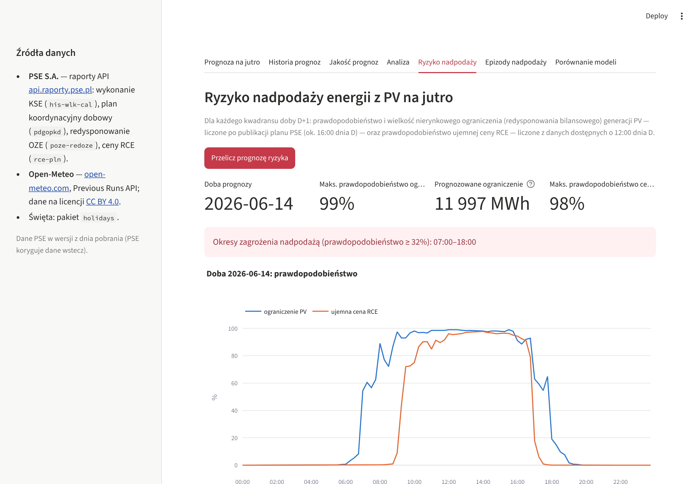
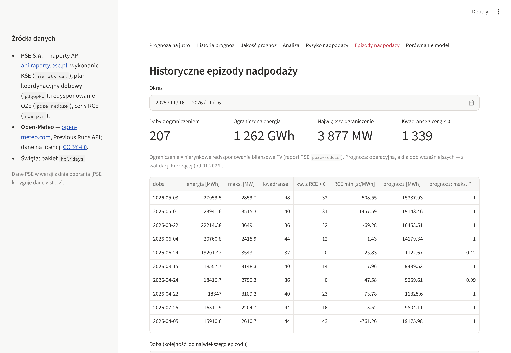
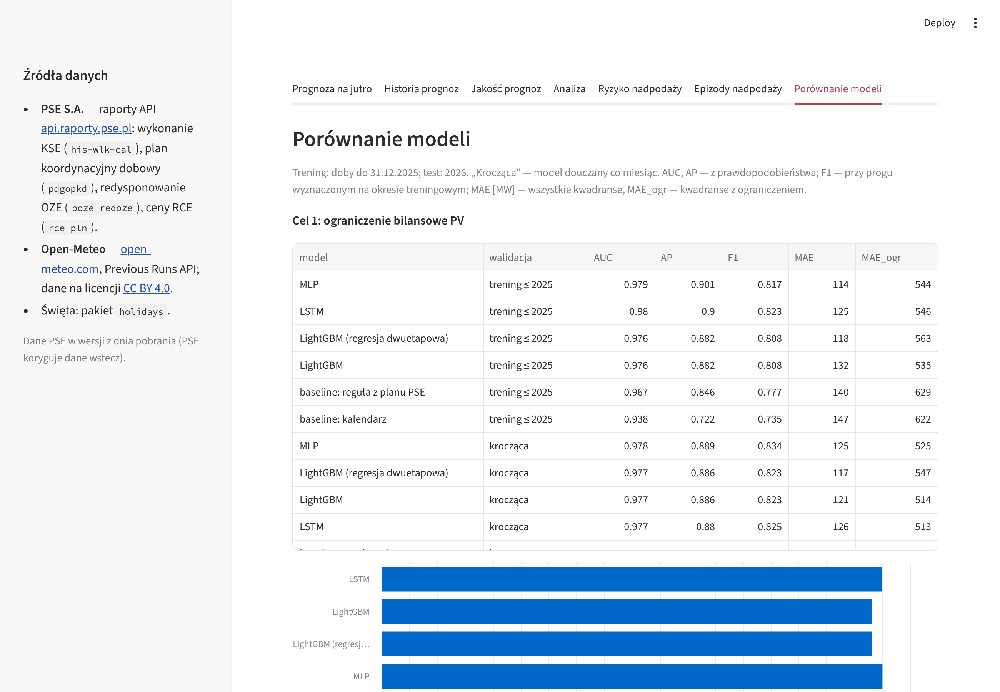

# Podręcznik użytkownika

System prognozowania zapotrzebowania netto i ryzyka nadpodaży energii z fotowoltaiki w KSE. Stan: 16.11.2026.

## 1. Do czego służy
- **Prognoza zapotrzebowania netto** (zapotrzebowanie − generacja PV) na każdą godzinę jutra.
- **Ryzyko nadpodaży na jutro**, dla każdego kwadransa: prawdopodobieństwo i wielkość ograniczenia generacji PV przez operatora (nierynkowe redysponowanie bilansowe) oraz prawdopodobieństwo ujemnej ceny energii (RCE).
- **Przegląd historii**: epizody nadpodaży, jakość prognoz, porównanie modeli.

Dane: publiczne raporty PSE i prognozy pogody Open-Meteo. System nie wymaga logowania.

## 2. Uruchomienie
Wymagania: Docker, `uv` (Python 3.12). Szczegóły dla Windows, telefonu i chmury: `docs/srodowisko.md`.

```bash
cp .env.example .env          # ustaw hasło bazy
uv sync
docker compose up -d          # baza danych i dashboard (http://localhost:8501)
uv run kse-init               # dane PSE i pogoda, walidacja modelu P2, prognoza netto na jutro (ok. 10 min za pierwszym razem)
uv run kse-inz init           # zbiór uczący, modele ryzyka, prognoza ryzyka na jutro (ok. 7 min za pierwszym razem)
```
Dashboard bez Dockera: `uv run kse-app`.

## 3. Codzienna praca
| Kiedy | Co | Jak |
|---|---|---|
| ok. 12:00 | prognoza netto na jutro | automatycznie (GitHub Actions) albo przycisk „Przelicz prognozę na jutro” / `uv run kse-p2 forecast` |
| ok. 12:00, po prognozie netto | ryzyko ujemnych cen na jutro | automatycznie albo przycisk „Przelicz prognozę ryzyka” / `uv run kse-inz forecast` |
| po 16:30 (po publikacji planu PSE) | ryzyko ograniczeń PV na jutro | automatycznie albo ten sam przycisk / to samo polecenie |

Polecenie `kse-inz forecast` zapisuje tylko to, czego danego dnia jeszcze nie ma: w południe prognozę cen, po południu prognozę ograniczeń. Prognoza cen z południa nie jest nadpisywana (opcja `--force` wymusza przeliczenie).

## 4. Widoki dashboardu
### Prognoza na jutro
Prognoza zapotrzebowania netto na 24 godziny jutra; po ok. 16:00 także prognoza PSE do porównania. Przycisk przelicza prognozę z najnowszych danych.

### Historia prognoz
Każda miniona doba: prognoza wykonana dzień wcześniej wobec wykonania i prognozy PSE; średni błąd dzienny (MAE), podział wg wersji kodu.

### Jakość prognoz
Prognozy historyczne (walidacja krocząca) w wybranym okresie: tabela błędów modeli i PSE, wykres tygodnia, błąd wg godziny i miesiąca.

### Analiza
Profile dobowe zapotrzebowania netto wg pory roku, krzywa kaczki, średnie miesięczne.

### Ryzyko nadpodaży


- **Doba prognozy** — doba, której dotyczy prognoza (jutro).
- **Maks. prawdopodobieństwo ograniczenia PV** i **Prognozowane ograniczenie** (energia w MWh; w podpowiedzi maksimum w MW).
- **Okresy zagrożenia nadpodażą** — przedziały czasu, w których prawdopodobieństwo ograniczenia PV przekracza próg modelu (czerwony komunikat); zielony komunikat oznacza brak takich okresów.
- **Wykres prawdopodobieństwa** — dla każdego kwadransa: ograniczenie PV (niebieska linia) i ujemna cena RCE (pomarańczowa).
- **Wykres prognozowanego ograniczenia PV** w MW i **tabela kwadransowa**.
- Jeśli plan PSE na jutro nie jest jeszcze opublikowany, widok pokazuje tylko ryzyko cen i ostrzeżenie; prognoza ograniczeń pojawi się po przeliczeniu po ok. 16:30.

Jak czytać: prawdopodobieństwo 80% dla kwadransa oznacza, że w podobnych warunkach ograniczenie występowało w ok. 8 przypadkach na 10. Wielkość w MW to wartość oczekiwana — największe ograniczenia są zwykle niedoszacowane.

### Epizody nadpodaży


Lista dób z ograniczeniem PV w wybranym okresie, od największej: ograniczona energia, maksimum, liczba kwadransów, liczba kwadransów z ceną ujemną, najniższa cena, prognoza systemu. Po wyborze doby: przebieg ograniczenia wobec prognozy i planowanej generacji PV, cena RCE, prognozowane prawdopodobieństwa. Prognozy są dostępne dla dób od 01.2026.

### Porównanie modeli


Metryki wszystkich modeli na okresie testowym 2026: modele bazowe, LightGBM, sieci MLP i LSTM (cel 1) oraz modele cen ujemnych (cel 2). AUC i AP — jakość rozróżniania kwadransów z ograniczeniem (im bliżej 1, tym lepiej); F1 — trafność przy progu decyzyjnym; MAE — średni błąd wielkości w MW.

## 5. Polecenia
| Polecenie | Działanie |
|---|---|
| `uv run kse-init` | dane, baza, walidacja P2, prognoza netto na jutro |
| `uv run kse-inz init` | zbiór uczący, eksperymenty (jeśli brak), prognoza ryzyka |
| `uv run kse-p2 forecast` | prognoza netto na jutro |
| `uv run kse-inz forecast` | prognoza ryzyka nadpodaży na jutro |
| `uv run kse-inz dataset` | pełna przebudowa zbioru uczącego i statystyki |
| `uv run kse-inz c1` / `c2` | eksperymenty: ograniczenia PV / ceny ujemne |
| `uv run kse-inz nn` | sieci MLP i LSTM (wcześniej `uv sync --group nn`) |
| `uv run kse-data report` | raport kompletności danych |
| `uv run pytest` | testy |

## 6. Typowe problemy
| Objaw | Przyczyna i rozwiązanie |
|---|---|
| „Brak prognozy P2 na … — najpierw `uv run kse-p2 forecast`” | prognoza ryzyka korzysta z prognozy netto; przelicz najpierw prognozę netto |
| „Plan PSE na … nie jest jeszcze opublikowany” | PSE publikuje plan ok. 16:00; przelicz prognozę ryzyka później |
| Brak pogody / HTTP 429 | limit darmowego API Open-Meteo; ponów po kilku minutach — prognoza zostanie policzona z ostrzeżeniem o brakujących cechach |
| Widoki inż puste | uruchom `uv run kse-inz init` |
| Dashboard nie łączy się z bazą | `docker compose up -d`; sprawdź `DATABASE_URL` w `.env` |

## 7. Ograniczenia
- Dane PSE są korygowane wstecz; system używa wersji z dnia pobrania.
- Dane o ograniczeniach PSE publikuje z opóźnieniem — model ograniczeń uczy się na dobach starszych niż 30 dni.
- Modele mają w danych jeden pełny sezon fotowoltaiczny (2025) i część 2026.
- Ograniczenia sieciowe (lokalne) nie są prognozowane — z dostępnych danych nie da się ich przewidzieć.
